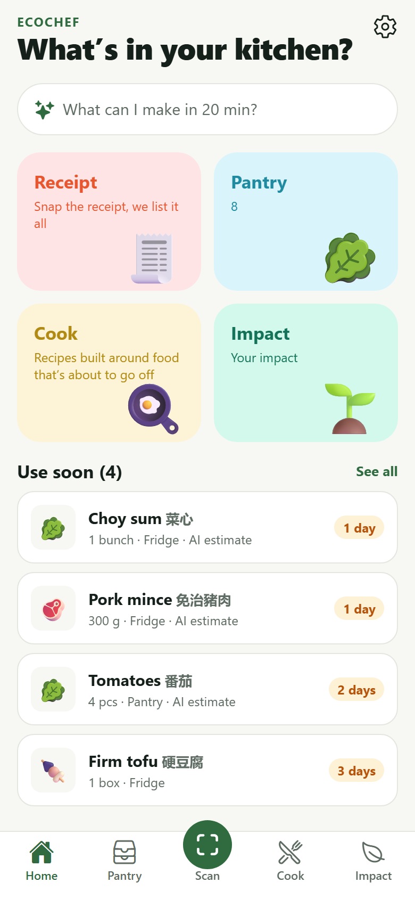
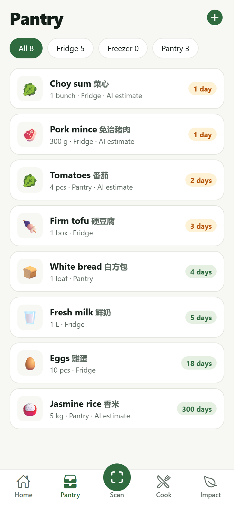
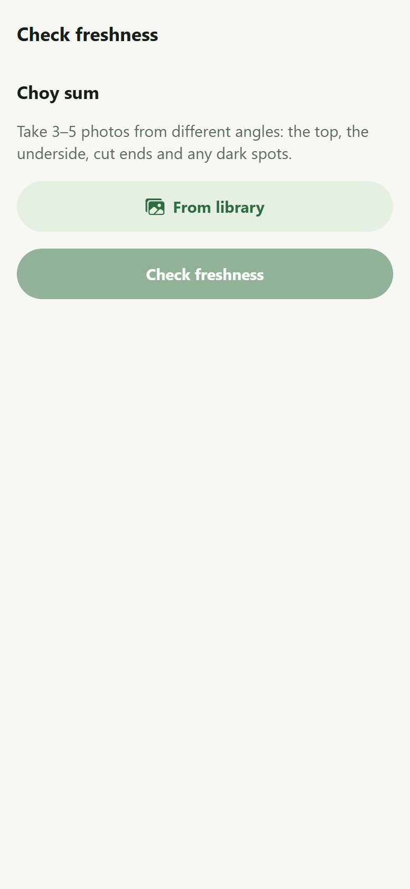
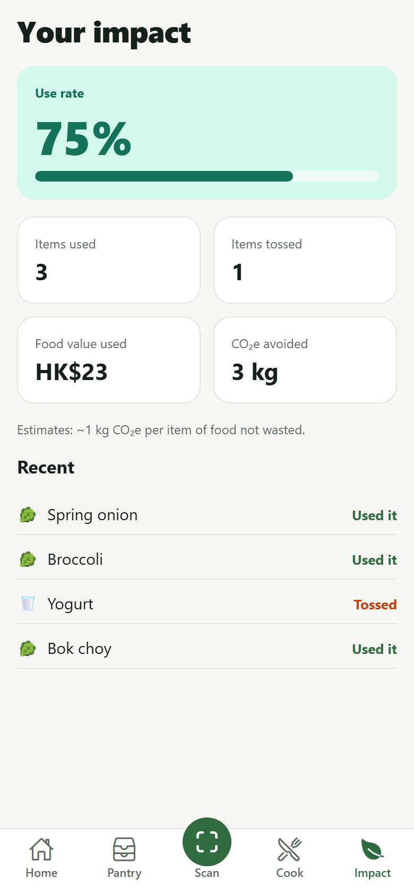

# EcoChef

> **Status: work in progress.** The app runs and the core inventory flow works. The AI features are built but not yet tested against live responses.

EcoChef is an AI-native food inventory app for Hong Kong households. Snap a photo of a receipt, a grocery haul or an expiry label, and it adds the items to your pantry with an estimated (or read-off) expiry date. It then helps you use things up before they go off: it reminds you the day before, suggests recipes built around what's expiring, and answers cooking questions with your inventory in mind.

The problem it targets: Hong Kong produces over 3,000 tonnes of food waste a year, about 70% of it from households. Apartment living makes composting hard, and people shop at both wet markets and supermarkets, so food is easy to lose track of.

## Features

| | |
|---|---|
| **Scan** | Receipt, grocery haul or expiry-label photos. The AI returns structured items (EN and 繁中 names, quantity, storage, expiry, price). You review them before saving. |
| **Pantry** | Everything you have, sorted by what expires first. Filter by fridge, freezer or pantry. Mark items as used, partly used or tossed; move items to the freezer. |
| **Freshness check** | For items with no expiry label: take 3–5 photos from different angles and get a condition (fresh, use soon, throw out or not sure), a days-left range, the visible signs, and a confidence level. Hard safety rules apply: visible mould or slime always means throw out, and meat, seafood, dairy, eggs and tofu never show as fresh. Saving the estimate sets the expiry and keeps a history. |
| **Cook** | Three recipes built around soon-to-expire food, assuming a typical HK kitchen. |
| **Ask EcoChef** | A chat assistant that can see your current inventory. |
| **Reminders** | A local notification at 9am the day before food expires. |
| **Impact** | Use rate, items used vs. tossed, the HK$ value of food used, and an estimated CO₂e saving. |
| **Languages** | English and Traditional Chinese, set from your device and changeable in Settings. |

## Screenshots

Captured from the web build at phone size, with sample data (not real household records).

<p align="center">
  
  
  
  
</p>

## Tech

- **App:** Expo (SDK 58), React Native, Expo Router, TypeScript, Zustand, AsyncStorage
- **AI:** Claude (`claude-opus-5-5`) with vision and structured outputs, called from server-only API routes so the key never ships in the app
- **Data:** local-first for now; the store is designed so a sync backend can be added later

## Repository layout

```
PRODUCT.md            Product spec: who it's for, core loop, scope
design question .pdf  Early pitch deck (cover still uses the working name "Foodflow")
mobile/               The Expo app
  src/app/            Screens and API routes (Expo Router)
  src/lib/            Store, API client, dates, notifications, translations
  src/server/         Claude integration (server only)
```

## Run it locally

```bash
cd mobile
npm install
npx expo start          # press w for web, or scan the QR code with Expo Go
```

To enable the AI features, copy `mobile/.env.example` to `mobile/.env` and add your Anthropic API key. Without a key everything else still works. Use **Load sample groceries** on the Home screen to try the app without scanning.

## Roadmap

- [ ] Test the scan, recipe, chat and freshness-check features against live responses
- [ ] Feedback on freshness estimates (was it right?) to measure accuracy
- [ ] Test camera and notifications on a real phone
- [ ] Check the Chinese UI text with native speakers
- [ ] Deploy the AI routes and build with EAS
- [ ] Optional accounts and cloud sync
- [ ] Parked for later: food donation map, household sharing, barcode scanning

## Not in this repo

The Figma design source (about 150 MB) is kept out of git because of GitHub's file size limit. The Figma file is the source for the 2024 designs, which this rebuild has partly replaced.

## License

Not yet chosen. All rights reserved until a license is added.
